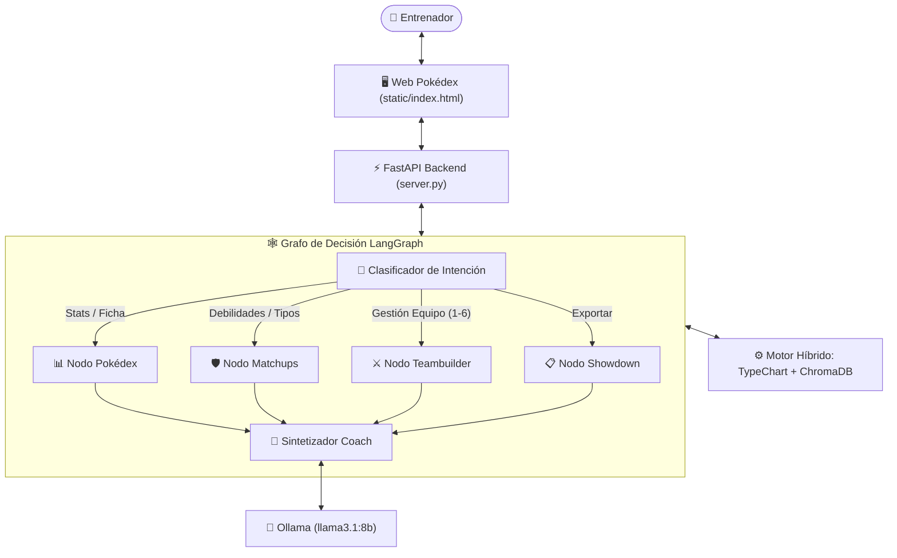

# ⚡ PokeEstratega-AI: Asistente y Asesor Competitivo de Pokémon

Sistema inteligente de asesoramiento y teambuilding competitivo para Pokémon (basado en los datos y estadísticas oficiales de **Pokémon Añil**), construido con **LangGraph**, **FastAPI**, **ChromaDB** y modelos de lenguaje locales con **Ollama** (`llama3.1:8b` y `nomic-embed-text`).

---

## 🌟 Características Principales

1. **Motor Determinista de Coberturas (0% Alucinaciones)**:
   - Cálculo matemático exacto de debilidades compuestas ($4\times$, $2\times$), resistencias ($0.5\times$, $0.25\times$) e inmunidades ($0\times$) sobre 18 tipos elementales.
   - Auditoría de equipo: Identifica debilidades compartidas críticas en equipos de hasta 6 Pokémon y detecta tipos sin cobertura ofensiva STAB.
2. **Grafo de Decisión con Memoria de Sesión (LangGraph)**:
   - Enrutamiento inteligente de intenciones: Consultas de Pokédex, análisis de matchups, gestión de equipo y exportación Showdown.
   - Mantiene en memoria el equipo activo del usuario durante la conversación.
3. **Exportador a Pokémon Showdown**:
   - Genera automáticamente sets competitivos estándar (roles como *Special Sweeper*, *Physical Wall*, naturalezas, EVs y selección de 4 movimientos óptimos) listos para copiar y pegar en Showdown.
4. **Interfaz Web Cyber-Pokédex (`static/`)**:
   - Panel visual con chat interactivo en tiempo real.
   - Badges con los colores oficiales de cada tipo elemental.
   - Barras gráficas de estadísticas base (PS, Atq, Def, Atq. Esp, Def. Esp, Vel) y BST.
   - Teambuilder lateral de 6 slots con botón de copia rápida Showdown.
5. **Contenedorización Completa con Docker Compose**:
   - Despliegue con un único comando unificando el servidor Ollama y la API de FastAPI.

---

## 🏗️ Arquitectura del Sistema



---

## 📁 Estructura del Proyecto

```text
PokeEstratega-AI/
├── data/                    # Datasets de Pokémon Añil (PBS)
│   ├── pokemon.txt          # 1004 Pokémon con stats, tipos y learnsets
│   ├── moves.txt            # Más de 700 movimientos y descripciones
│   ├── abilities.txt        # Habilidades y efectos
│   └── types.txt            # Tabla de tipos y multiplicadores
├── engine/                  # Motor de cálculo y lógica matemática
│   ├── pbs_parser.py        # Parser optimizado de archivos PBS
│   ├── type_chart.py        # Calculadora de debilidades y auditoría de equipo
│   ├── showdown.py          # Serializador y generador de sets Showdown
│   └── indexing.py          # Indexación vectorial semántica con ChromaDB
├── graph/                   # Orquestación con LangGraph
│   ├── state.py             # Estado compartido tipado (PokeState)
│   ├── nodes.py             # Nodos del grafo (Pokedex, Matchups, Team, Showdown)
│   └── graph.py             # Compilación del StateGraph
├── static/                  # Frontend Web Temático
│   ├── index.html           # Interfaz Cyber-Pokédex
│   ├── style.css            # Estilos dark theme, badges y barras de stats
│   └── app.js               # Lógica del cliente, Markdown y Teambuilder
├── server.py                # Servidor API REST con FastAPI
├── requirements.txt         # Dependencias Python
├── Dockerfile               # Contenedor Docker para FastAPI
├── docker-compose.yml       # Orquestación multi-contenedor (FastAPI + Ollama)
└── README.md                # Documentación del proyecto
```

---

## 🚀 Puesta en Marcha

### Opción 1: Ejecución en Local

1. **Requisitos previos**:
   - Python 3.10 o superior.
   - [Ollama](https://ollama.com) corriendo con los modelos:
     ```bash
     ollama pull llama3.1:8b
     ollama pull nomic-embed-text
     ```

2. **Instalar dependencias**:
   ```bash
   pip install -r requirements.txt
   ```

3. **Iniciar el servidor**:
   ```bash
   uvicorn server:app --reload --port 8000
   ```

4. **Acceder a la aplicación**:
   - **Interfaz Web Pokédex**: [http://localhost:8000](http://localhost:8000)
   - **Documentación Swagger / API**: [http://localhost:8000/docs](http://localhost:8000/docs)

---

### Opción 2: Con Docker Compose

```bash
docker compose up -d --build
```
Abre en tu navegador [http://localhost:8000](http://localhost:8000).

---

## 📋 Endpoints Principales de la API

| Método | Ruta | Descripción |
| :--- | :--- | :--- |
| `GET` | `/` | Interfaz Web Cyber-Pokédex |
| `POST` | `/chat` | Envía un mensaje al grafo LangGraph (mantiene sesión y equipo) |
| `GET` | `/team/{session_id}` | Obtiene el equipo actual de 6 Pokémon y su auditoría de debilidades |
| `POST` | `/team/{session_id}/add` | Añade un Pokémon manualmente al equipo |
| `POST` | `/team/{session_id}/remove` | Elimina un Pokémon del equipo |
| `GET` | `/team/{session_id}/export-showdown` | Devuelve el equipo en formato texto Pokémon Showdown |
| `GET` | `/pokemon/{name_or_id}` | Ficha completa con stats, tabla de daño y set recomendado |
| `GET` | `/health` | Verificación de estado de la aplicación |
