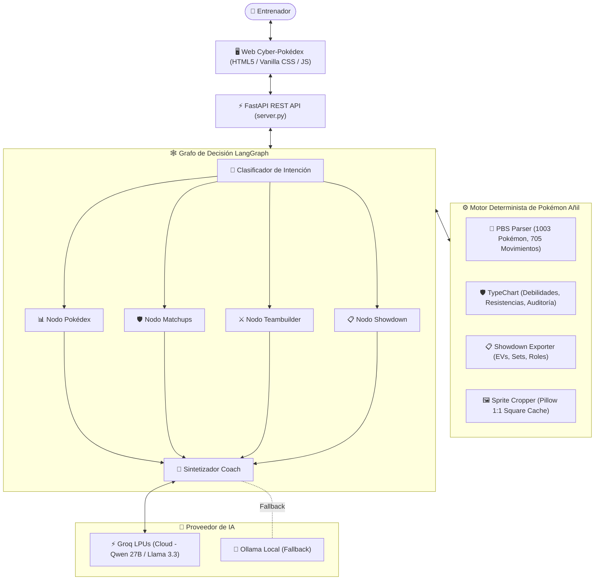

# ⚡ PokeEstratega-AI: Asistente & Teambuilder Competitivo

[](https://pokeestratega-ai.onrender.com/)
[](https://fastapi.tiangolo.com/)
[](https://langchain-ai.github.io/langgraph/)
[](https://groq.com/)
[](https://www.python.org/)
[](https://www.docker.com/)

Sistema inteligente de asesoramiento táctico, análisis de debilidades y **Teambuilder Competitivo interactivo** de Pokémon (basado en los datos y estadísticas oficiales de **Pokémon Añil** - Pokédex de 1003 Pokémon). 

Desplegado en producción sin base de datos externa, con inferencia en la nube ultra-rápida mediante **Groq LPUs** y motor determinista con **cero alucinaciones**.

🌐 **Acceso en Producción:** [https://pokeestratega-ai.onrender.com](https://pokeestratega-ai.onrender.com)

---

## 🌟 Características Principales

### 1. Teambuilder Interactivo en 4 Pestañas
Personalizador completo de Pokémon competitivo con interfaz fluida y visual:
- **⚔️ Movimientos**:
  - 4 Ranuras activas arriba precargadas con los movimientos sugeridos por el meta.
  - Cajón inferior con todos los movimientos aprendibles (nivel y huevo).
  - Tarjetas coloreadas según el tipo elemental del ataque (Fuego, Dragón, Tierra, Siniestro, etc.).
  - Badges informativos de categoría (⚔️ Físico, 🔮 Especial, 🛡️ Estado), Potencia, Precisión y PP.
  - **Drag & Drop nativo HTML5**: Arrastra movimientos del cajón a cualquier ranura, reordena entre ranuras o haz clic directo para equipar/desequipar.
  - Botón de un clic: *"✨ Restaurar 4 Recomendados"*.
- **✨ Habilidad**:
  - Habilidad competitiva recomendada arriba con explicación táctica.
  - Selector de todas las habilidades con distintivo especial para **Habilidad Oculta**.
- **🎒 Objeto**:
  - Objeto competitivo sugerido (Vidasfera, Restos, Pañuelo Elección, etc.).
  - Cajón de objetos competitivos viables con buscador en tiempo real.
- **🧬 Naturaleza**:
  - Naturaleza óptima sugerida según el rol de combate (Sweeper, Wall, Tank).
  - Selector con insignias claras de modificación de estadísticas (**+10%** en verde / **-10%** en rojo).
- **Filtro de Tipos en Cuadrícula**:
  - 18 tipos elementales adaptados en filas compactas (`flex-wrap`) sin scroll lateral.
  - Botones con los colores oficiales de cada tipo y efecto glow al seleccionar.

### 2. Motor de Sprites Cuadrados 1:1
- Procesamiento en el backend (`crop_first_frame` con Pillow) que extrae el primer fotograma estático de las tiras animadas de Pokémon Essentials (Battlers de 7298×82 px e Icons de 128×64 px) a relación cuadrada **1:1** (82×82 px y 64×64 px).
- Caché optimizada y fallback automático a CDNs oficiales de **PokeAPI** en la nube.

### 3. Motor Determinista de Coberturas (0% Alucinaciones)
- Cálculo matemático exacto de debilidades compuestas ($4\times$, $2\times$), resistencias ($0.5\times$, $0.25\times$) e inmunidades ($0\times$) sobre 18 tipos elementales.
- **Auditoría de Equipo**: Detecta debilidades compartidas críticas en equipos de hasta 6 Pokémon y analiza la cobertura ofensiva STAB.

### 4. Doble Motor de Inferencia (Cloud & Local)
- **Groq Cloud LPUs (Primario en Producción)**: Respuestas tácticas en ~200 ms usando modelos avanzados (`qwen/qwen3.8-27b` o `llama-3.3-70b-versatile`).
- **Ollama Local (Fallback)**: Soporte para ejecución offline con `llama3.1:8b` y `nomic-embed-text`.
- **Motor Determinista (Fallback Seguro)**: Si los modelos no están disponibles, el motor matemático genera la ficha táctica exacta.

### 5. Guardrails de Dominio (Seguridad)
- Filtro estricto en LangGraph que garantiza que el agente responda única y exclusivamente sobre Pokémon, estrategia y teambuilding, rechazando preguntas ajenas (programación, tareas, etc.) con personalidad de entrenador.

### 6. Exportación a Pokémon Showdown
- Genera sets competitivos estándar (roles, habilidades, objetos, naturalezas, EVs y movimientos) listos para copiar y pegar directamente en **Pokémon Showdown**.

---

## 🏗️ Arquitectura del Sistema



---

## 📁 Estructura del Proyecto

```text
PokeEstratega-AI/
├── data/                    # Datasets oficiales de Pokémon Añil (PBS)
│   ├── pokemon.txt          # 1003 Pokémon con stats base, tipos y learnsets
│   ├── moves.txt            # Más de 700 movimientos y descripciones
│   ├── abilities.txt        # Habilidades y efectos
│   └── types.txt            # Matriz de tipos y multiplicadores
├── engine/                  # Motor de cálculo y lógica matemática
│   ├── pbs_parser.py        # Parser optimizado de archivos PBS
│   ├── type_chart.py        # Calculadora de debilidades y auditoría de equipo
│   ├── showdown.py          # Serializador y generador de sets Showdown
│   └── indexing.py          # Indexación semántica
├── graph/                   # Orquestación de agentes con LangGraph
│   ├── state.py             # Estado compartido tipado (PokeState)
│   ├── nodes.py             # Nodos del grafo (Groq, Guardrails, Matchups, Team)
│   └── graph.py             # Compilación del StateGraph
├── static/                  # Frontend Web Cyber-Pokédex
│   ├── index.html           # Interfaz de usuario con 4 pestañas y modal
│   ├── style.css            # Estilos dark theme, drag & drop y paleta de tipos
│   └── app.js               # Lógica cliente, drag & drop, filtros y sincronización
├── server.py                # Servidor API REST con FastAPI y endpoints de sprites
├── Dockerfile               # Contenedor optimizado para despliegue en Render/Cloud
├── docker-compose.yml       # Orquestación multi-contenedor para entorno local
├── requirements.txt         # Dependencias Python
├── .env.example             # Plantilla de variables de entorno (Groq API)
└── README.md                # Documentación del proyecto
```

---

## 🚀 Despliegue y Puesta en Marcha

### Opción 1: En Producción (Render.com)

1. Conecta tu repositorio de GitHub a **Render.com**.
2. Selecciona **New Web Service** y el entorno **Docker**.
3. Configura las variables de entorno en Render:
   - `GROQ_API_KEY`: Tu clave de API de Groq (`gsk_...`).
   - `GROQ_MODEL`: `qwen/qwen3.8-27b` (o `llama-3.3-70b-versatile`).
4. Haz clic en **Deploy Web Service**. ¡Listo en 2 minutos con HTTPS automático!

---

### Opción 2: Ejecución en Local

1. **Clonar el repositorio**:
   ```bash
   git clone https://github.com/Mariogarluu/PokeEstratega-AI.git
   cd PokeEstratega-AI
   ```

2. **Crear y activar entorno virtual**:
   ```bash
   python -m venv .venv
   # En Windows:
   .\.venv\Scripts\activate
   # En Linux/macOS:
   source .venv/bin/activate
   ```

3. **Instalar dependencias**:
   ```bash
   pip install -r requirements.txt
   ```

4. **Configurar variables de entorno**:
   Copia el archivo `.env.example` a `.env` y añade tu clave:
   ```env
   GROQ_API_KEY=gsk_tu_clave_de_groq
   GROQ_MODEL=qwen/qwen3.8-27b
   ```

5. **Iniciar el servidor**:
   ```bash
   uvicorn server:app --reload --port 8000
   ```
   Abre en tu navegador [http://localhost:8000](http://localhost:8000).

---

### Opción 3: Con Docker Compose (Local)

```bash
docker compose up -d --build
```
Abre en tu navegador [http://localhost:8000](http://localhost:8000).

---

## 📋 Endpoints Principales de la API

| Método | Ruta | Descripción |
| :--- | :--- | :--- |
| `GET` | `/` | Interfaz Web Cyber-Pokédex |
| `POST` | `/chat` | Chat táctico con LangGraph + Groq LPUs |
| `GET` | `/pokemon-list` | Lista de los 1003 Pokémon con BST y rol competitivo |
| `GET` | `/pokemon/{id}/custom-data` | Datos completos de personalización (movimientos aprendibles, habilidades, objetos, naturalezas) |
| `GET` | `/pokemon/{name_or_id}` | Ficha técnica rápida con stats base y cálculo de debilidades |
| `GET` | `/sprite/{poke_id}` | Sprite del Pokémon en formato cuadrado 1:1 cacheado |
| `GET` | `/icon/{poke_id}` | Icono del Pokémon en formato cuadrado 1:1 cacheado |
| `GET` | `/team/{session_id}` | Obtiene el equipo activo y su auditoría de debilidades |
| `POST` | `/team/{session_id}/add` | Añade un Pokémon estándar al equipo |
| `POST` | `/team/{session_id}/add_custom` | Añade un Pokémon con movimientos, habilidad, objeto y naturaleza personalizados |
| `POST` | `/team/{session_id}/remove` | Elimina un Pokémon del equipo |
| `POST` | `/team/{session_id}/clear` | Vacía el equipo activo |
| `GET` | `/team/{session_id}/export-showdown` | Exporta el equipo en formato texto de Pokémon Showdown |
| `GET` | `/health` | Verificación de estado de la aplicación |

---

## 📄 Licencia

Este proyecto ha sido desarrollado como práctica avanzada del **Bootcamp de Programación e Inteligencia Artificial**. Datos de combate inspirados en la base de datos de Pokémon Añil y Pokémon Essentials.
